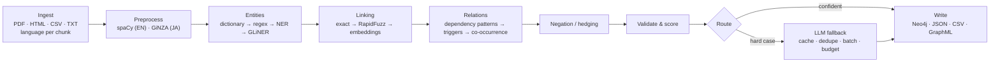

# leankg

**Turn English and Japanese documents into a Neo4j knowledge graph. Classic NLP does most
of the work; an LLM is asked only about the sentences the rules can't settle.**


-lightgrey)

```text
leankg run — domain=manufacturing llm=groq (openai/gpt-oss-20b)
lang  docs  sents  mentions  entities  triples  neg  hard%  llm%  cache%  tok_in  tok_out   cost$
  en     7     30        36        30       18    0   13.3  13.3     0.0    1260      900  0.0004
  ja     2     22        29        26       10    0    0.0   0.0     0.0       0        0  0.0000
 all     9     52        65        33       18    0    7.7   7.7     0.0    1260      900  0.0004
duration 5.88s · 91.9 docs/min · llm requests 1 · cost/1k docs $0.0405
```

Run the same build again and it costs **$0**: every LLM answer comes from the cache
(`llm requests 0 · cache% 100`).

---

## Why leankg?

Most "documents → knowledge graph" pipelines send every sentence to a large model. You
pay for every sentence, wait for every sentence, and get a slightly different graph on
every run. leankg works the other way round:

- **Rules first, LLM last.** Dictionaries, regexes, dependency patterns, a trigger lexicon
  and spaCy/GiNZA handle what they can. Only *hard cases* go to the LLM (on the sample
  data: 6–17% of sentences). Every run reports `llm_call_rate`, `cache_hit_rate` and
  `est_cost_usd`.
- **Runs fully offline.** `--llm none` is a complete pipeline; hard cases are kept as
  flagged, unverified candidates instead of being dropped.
- **English and Japanese from day one.** GiNZA parsing, character-level dictionary
  matching (油圧ポンプ matches even when the tokenizer splits it), Japanese negation and
  hedging rules (〜しなかった, 〜かもしれない, 〜ないとは言えない), a CJK full-text index in Neo4j.
  「ストレス」 and "stress" become **one** entity.
- **Domains are data, not code.** A domain pack is an ontology, dictionaries, patterns,
  model names and LLM hints. The bundled `manufacturing` pack was built with zero engine
  changes.
- **Provenance on everything.** Every node and edge records document, chunk, sentence
  offsets, method (`dict | regex | ner | gliner | dep | trigger | cooc | llm`), language
  and confidence. "Exercise did *not* reduce stress" is stored as **negative evidence**,
  never as a fact.

## How it works



Every stage is a class with `process(doc) -> doc`. You can test any stage on its own or
skip it by config. A sentence goes to the LLM only if it has entities the schema allows to
relate but no confident rule relation, an ambiguous entity link, a low-confidence rule
triple, or complex negation. The LLM sees the sentence, a numbered entity list and the
allowed relation types, and answers with **indices only** under a strict JSON schema. The
answer has the same shape for English and Japanese and is validated locally.

## Quick start

### Install

```bash
pip install "leankg[ja]"                 # core + Japanese (GiNZA)
python -m spacy download en_core_web_sm
```

| Extra | Adds |
|---|---|
| `ja` | GiNZA `ja_ginza`, SudachiPy, jaconv |
| `med` | scispaCy + negspaCy (English biomedical) |
| `gliner` / `embed` | GLiNER zero-shot NER / multilingual sentence embeddings (pull in PyTorch) |
| `neo4j` | Neo4j driver |
| `groq` / `ollama` | LLM fallback via Groq or a local Ollama model |

### Build a graph offline (no API key)

```bash
leankg build examples/health_stress --domain health_stress --llm none --out json --out-path out/
```

```python
from leankg import Pipeline

pipe = Pipeline.from_domain("manufacturing", llm="none")
report = pipe.build("examples/manufacturing", out="json", out_path="out/")

print(report.llm_call_rate, report.hard_case_rate, report.by_lang["ja"].triples)
for t in pipe.graph.facts():
    print(t.head, t.type, t.tail, "(negated)" if t.negated else "", t.method, t.confidence)
```

### Write to Neo4j

```bash
docker compose up -d                     # Neo4j 5 + APOC on bolt://localhost:7687
cp .env.example .env                     # NEO4J_PASSWORD matches docker-compose
leankg build examples/manufacturing --domain manufacturing --out neo4j --csv-text-column summary
```

Open http://localhost:7474 and try `domains/manufacturing/demo_queries.cypher`:

```cypher
// Japanese input → entities via the CJK full-text index
CALL db.index.fulltext.queryNodes('entity_names', '焼き付き') YIELD node, score
RETURN node.id, node.name, node.name_ja, score;

// Graph なぜなぜ分析 (5 Whys): walk CAUSED_BY chains back from a failure
MATCH path = (f:FailureMode)-[:CAUSED_BY*1..5]->(root)
WHERE all(r IN relationships(path) WHERE r.negated = false AND r.status = 'accepted')
RETURN [n IN nodes(path) | coalesce(n.name_ja, n.name)] AS why_chain;
```

The demo file also covers failure/fix tables with provenance, a "seen this defect
before?" vector search, explicitly ruled-out causes, and which TPS concepts prevent which
failures.

### Turn on the LLM fallback (Groq)

```bash
pip install "leankg[groq]"
echo "GROQ_API_KEY=gsk_..." >> .env      # .env is git-ignored
leankg llm-models                        # check which models your key can use
leankg build examples --domain manufacturing --llm groq --csv-text-column summary
```

Model IDs, prices and budgets live in `leankg.toml`, never in code (Groq retires models
often). The default is `openai/gpt-oss-20b` with `reasoning_effort = "low"`, a 500-request
/ 400k-token budget per run, and a SQLite cache. When the budget runs out, the remaining
hard cases are kept as unverified candidates; the build doesn't fail. `--llm ollama` works
the same way with a local model.

## Benchmark

Status 2026-11-21. LLM = Groq `openai/gpt-oss-20b`. Relation F1, share of sentences sent to
the LLM, and cost per 1,000 documents:

| Pack | Lang | A · rules only | B · rules + models | C · rules + LLM fallback | D · LLM only |
|---|---|---|---|---|---|
| manufacturing | en | 0.72 · 0% · $0 | 0.72 · 0% · $0 | **0.81** · 16.7% · $0.013 | 0.89 · 94.4% · $0.052 |
| manufacturing | ja | 0.78 · 0% · $0 | 0.78 · 0% · $0 | **0.81** · 11.1% · $0.012 | 0.88 · 94.4% · $0.066 |
| health_stress | en | **1.00** · 0% · $0 | 1.00 · 0% · $0 | 0.94 · 5.6% · $0.008 | 0.88 · 94.4% · $0.037 |
| health_stress | ja | **0.93** · 0% · $0 | 0.93 · 0% · $0 | 0.88 · 11.1% · $0.010 | 0.84 · 88.9% · $0.037 |

Entity F1 is 0.96–1.00 in every setup. Throughput on a laptop CPU: A/B 500–900 docs/min,
C 200–350, D 21–170 (bounded by Groq free-tier rate limits).

> **Caveats.** These are smoke-test numbers on **18 hand-written sentences per language
> per pack** (`domains/<pack>/eval/fixtures/`), written by the same people who wrote the
> dictionaries, so entity scores are optimistic and one relation moves F1 by several
> points. Independently labelled Japanese gold sets (~100 sentences per pack) are in
> progress. Setup B here = rules + spaCy/GiNZA NER + multilingual embedding linking
> (no change on these sets); GLiNER is installed but currently fails to load with
> `transformers` 5.x (it misreads mDeBERTa's SentencePiece tokenizer), so it didn't run.

**What the numbers say:**

- **Manufacturing:** the LLM fallback raises relation F1 while sending only 11–17% of
  sentences. LLM-only scores higher but sends ~94% of sentences at 4–5× the cost. Most of
  the gap comes from one design rule: a sentence with one confident rule hit is never sent,
  so its other candidate pairs stay unverified.
- **Health:** the rules were already right, and the LLM added debatable relations. It reads
  "headache and fatigue were common in the burnout group" as `HAS_SYMPTOM`, which the gold
  labels as no relation. Rules-first isn't automatically more accurate; it is cheaper,
  repeatable, and shows exactly where the LLM was used.
- **Public data, rules only (EN):** MaintIE's 1,076 maintenance work orders (types mapped
  approximately): entity F1 0.29 (precision 0.78, recall 0.18). NCBI Disease (400
  sentences): 0.00, since the stress pack has no genetic-disease vocabulary. Out-of-vocabulary
  recall is what setup B (GLiNER / scispaCy) is for.

Reproduce: `leankg eval --domain manufacturing --setup C --llm groq --fixtures`. See
[docs/EVAL.md](docs/EVAL.md) for metrics, the gold format and the Label Studio workflow.

## Domain packs

| Pack | Entity types | Relations |
|---|---|---|
| `health_stress` | Condition, Symptom, Stressor, Intervention, Biomarker, Instrument, Outcome | HAS_SYMPTOM, INCREASES_RISK_OF, REDUCES, TREATS, MEASURED_BY, ASSOCIATED_WITH |
| `manufacturing` | Machine, Component, FailureMode, Cause, Observation, MaintenanceAction, Station, Sensor, Countermeasure, TPSConcept | PART_OF, HAS_FAILURE_MODE, CAUSED_BY, DETECTED_BY, FIXED_BY, OCCURS_AT, PREVENTS |

A pack is a folder:

```
domains/<pack>/
  ontology.yaml                     # types, allowed from/to, labels {en, ja}
  dictionaries/*.csv                # id,type,lang,term,synonyms,source
  patterns/entities.jsonl           # regexes with "lang"
  patterns/relations.{en,ja}.yaml   # dependency patterns + trigger lexicon
  models.yaml                       # spaCy / NER label map / GLiNER labels / embeddings
  llm_hints.md, llm_hints.ja.md     # few-shot examples for the LLM
  eval/                             # gold data and CI fixtures
```

Shared concept IDs across language rows are what link 漏れ and "leak" into one entity.
Validation errors name the file and line. You can also import an existing ontology with
`leankg import-owl ontology.ttl` (it keeps `@ja` labels). Guide:
[docs/domain-packs.md](docs/domain-packs.md).

## Languages

Each language is a **`LanguageProfile`**. Stages never check the language; they ask the
profile how to normalize text, split sentences, match dictionary terms, measure windows
(tokens in English, bunsetsu in Japanese), decide which pairs are connected, and detect
negation. Japanese normalization folds full-width/half-width characters, hiragana/katakana
and long-vowel marks (ﾓｰﾀｰ = モーター = モータ) while keeping a map back to the original
offsets. Adding a language means adding a profile plus pack files:
[docs/adding-a-language.md](docs/adding-a-language.md).

## Command line

| Command | What it does |
|---|---|
| `leankg build PATH --domain X [--llm none\|groq\|ollama] [--out json\|csv\|graphml\|neo4j]` | Build a graph and print the RunReport |
| `leankg eval --domain X --setup A\|B\|C\|D [--lang en\|ja\|all] [--llm-budget N]` | Benchmark against gold data (markdown table + JSON report) |
| `leankg review-llm --domain X [--apply]` | Turn repeated LLM answers into trigger and dictionary rules |
| `leankg llm-models` | List the models your Groq key can use |
| `leankg import-owl FILE` | Convert OWL/RDF/TTL to a pack `ontology.yaml` |
| `leankg labelstudio config\|tasks\|convert` | Label gold data in Label Studio (character-level spans for Japanese) |

## Graph model

```
(:Document {id, title, source, lang})-[:HAS_CHUNK]->
(:Chunk {id, text, lang, embedding})-[:MENTIONS {start, end, method, confidence}]->
(:Entity:<Type> {id, name, name_ja, aliases_en, aliases_ja, ontology_id, lang_seen})
(:Entity)-[:<RELATION> {negated, confidence, method, status, evidence_count, chunk_ids, langs}]->(:Entity)
```

Writes are batched `UNWIND … MERGE` (1,000 rows) and idempotent. Repeated evidence
increments `evidence_count`. Indexes: uniqueness constraints, CJK full-text on entity names
and chunk text, and a vector index on chunk embeddings.

## Project layout

```
src/leankg/
  stages/        ingest · preprocess · entities · linking · relations · validate · route · write
  lang/          LanguageProfile, en, ja, detection, negation rules
  llm/           Groq · Ollama · fake · none clients, prompt, strict schema, cache, resolver, review
  domain/        pack models, loader, OWL import
  export/        JSON · CSV · NetworkX/GraphML · Neo4j
  eval/          gold format, metrics, harness, converters, Label Studio
domains/         health_stress, manufacturing (data only)
examples/        hand-written sample documents (EN + JA)
notebooks/       health_stress_en.ipynb, manufacturing_ja.ipynb (run with --llm none)
docs/            MkDocs site: architecture, packs, languages, cost controls, Groq setup, eval
```

## Development

```bash
uv sync --all-extras                        # everything
uv run ruff check . && uv run ruff format --check . && uv run mypy src && uv run pytest -q
docker compose up -d && uv run pytest -m integration   # Neo4j + live Groq (needs GROQ_API_KEY)
```

272 offline unit tests and 7 integration tests. CI runs lint, strict mypy and tests on
Python 3.11 and 3.12, plus an evaluation regression job that fails if F1 drops by more than
2 points. Never commit `.env`; a pre-commit hook blocks it.

> **Windows with Smart App Control:** it blocks spaCy's unsigned compiled modules in a
> Windows virtualenv. Develop in WSL (Ubuntu) instead; Linux and macOS are unaffected.

## Limitations

- The bundled packs are small and hand-written. For real use you need real dictionaries
  (or `import-owl`) and gold data from your domain.
- Trigger rules work on the surface text and can bridge clauses. "CBT treats insomnia, and
  meditation lowers cortisol" also yields CBT → cortisol.
- Japanese の-phrases (「ホースの亀裂」) are kept as low-confidence candidates on purpose;
  they need the LLM fallback to become facts.
- A sentence with one confident rule hit is never sent to the LLM, so its other candidate
  pairs stay unverified.
- Language detection is a kana/CJK-ratio heuristic, so Chinese text would be treated as
  Japanese. Only `en` and `ja` profiles exist today.

## Roadmap

- Independently labelled Japanese gold sets and re-benchmarking on them
- GLiNER numbers for setup B (pin a compatible `transformers` / `gliner` pair)
- Optional routing of leftover candidate pairs (recall vs. LLM calls)
- A Sudachi user dictionary built from pack terms
- Clause-aware trigger scoping
- More languages via new profiles
- Packs published as plugins through the `leankg.domains` entry point

## Licence

Apache-2.0 (see [LICENSE](LICENSE)). Models and datasets have their own licences, listed in
[docs/licences.md](docs/licences.md). Datasets are downloaded by scripts and never
committed.
