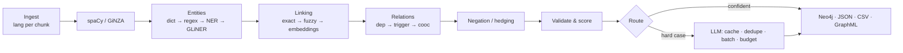

# leankg

**Turn English and Japanese documents into a Neo4j knowledge graph — classic NLP does most
of the work, an LLM (Groq) is called only for the hard cases the rules can't settle.**

- **Low LLM use.** Every run reports `llm_call_rate`, `cache_hit_rate` and `est_cost_usd`;
  `--llm none` runs fully offline. A second run over the same data is served from cache.
- **English and Japanese from day one.** One engine, swappable **language profiles**
  (`en`, `ja`): GiNZA, character-level dictionary matching, Japanese negation rules, a CJK
  full-text index; 「ストレス」 and "stress" become one entity.
- **Domain packs, not code.** `health_stress` and `manufacturing` ship as data (ontology,
  dictionaries, patterns, model names, LLM hints). Adding a domain changes no engine code.
- **Provenance on everything.** Every node and edge records document, chunk, sentence
  offsets, method (`dict|regex|ner|gliner|dep|trigger|cooc|llm`), language and confidence;
  negated statements are kept as negative evidence.

## 30-second quick start

```bash
pip install "leankg[ja]"                     # + "[neo4j,groq]" for Neo4j output / LLM fallback
python -m spacy download en_core_web_sm
leankg build examples/health_stress --domain health_stress --llm none --out json
```

```python
from leankg import Pipeline

pipe = Pipeline.from_domain("manufacturing", llm="none")
report = pipe.build("examples/manufacturing", out="json", out_path="out/")
print(report.llm_call_rate, report.by_lang["ja"].triples)
```

Neo4j: `docker compose up -d`, set `NEO4J_PASSWORD` in `.env`, add `--out neo4j`, then try
`domains/manufacturing/demo_queries.cypher` (Japanese full-text search, a graph
なぜなぜ分析 over `CAUSED_BY` chains, "seen this defect before?" by vector search).
Groq: put `GROQ_API_KEY` in `.env` and add `--llm groq` (see `docs/groq-setup.md`).

## Architecture



Each stage is a class with `process(doc) -> doc`, testable alone and skippable by config.
Details: `docs/architecture.md`.

## Benchmark

Status 2026-11-21. **Read the caveats.** Seed fixtures = 18 hand-written sentences per
language per pack (`domains/<pack>/eval/fixtures/`), written by the same people who wrote
the dictionaries, so entity scores on them are optimistic; independently labelled
Japanese gold sets (~100 sentences per pack) are pending. Setup B currently = rules +
spaCy/GiNZA NER (GLiNER and embeddings not yet installed in the benchmark environment).
C and D need a Groq key and are not run yet.

| Domain | Lang | Setup | Gold | Entity F1 | Relation F1 | LLM call rate | Cost / 1k docs |
|---|---|---|---|---|---|---|---|
| health_stress | en | A rules | seed (18) | 1.00 | 1.00 | 0% | $0 |
| health_stress | en | B rules+models | seed (18) | 1.00 | 1.00 | 0% | $0 |
| health_stress | ja | A rules | seed (18) | 0.99 | 0.93 | 0% | $0 |
| health_stress | ja | B rules+models | seed (18) | 0.99 | 0.93 | 0% | $0 |
| manufacturing | en | A rules | seed (18) | 1.00 | 0.72 | 0% | $0 |
| manufacturing | en | B rules+models | seed (18) | 1.00 | 0.72 | 0% | $0 |
| manufacturing | ja | A rules | seed (18) | 0.96 | 0.78 | 0% | $0 |
| manufacturing | ja | B rules+models | seed (18) | 0.96 | 0.78 | 0% | $0 |
| health_stress | en | A rules | NCBI Disease test, 400 sents (Condition only) | 0.00 | – | 0% | $0 |
| manufacturing | en | A rules | MaintIE gold, 1,076 texts (mapped types) | 0.29 (P 0.78, R 0.18) | 0.00 | 0% | $0 |
| manufacturing | en | B rules+models | MaintIE gold, 1,076 texts (mapped types) | 0.29 | 0.00 | 0% | $0 |
| any | en/ja | C leankg (Groq fallback) | | pending key | | | |
| any | en/ja | D Groq only | | pending key | | | |

Reproduce: `uv run leankg eval --domain <pack> --setup A --fixtures` (see `docs/EVAL.md`).

## Limitations
- The seed packs are small and hand-written; real use needs real dictionaries (or
  `leankg import-owl`) and gold data from your domain.
- Trigger rules are surface-level: they can bridge clauses ("CBT treats insomnia, and
  meditation lowers cortisol" also yields CBT → cortisol). Dependency patterns are
  precise but miss misparsed sentences (en_core_web_sm struggles with headline style).
- Japanese の-phrases (「ホースの亀裂」) are only low-confidence candidates by design; they
  need the LLM (setup C) to become facts.
- Following the routing rules, a sentence with one confident rule hit is never sent to the
  LLM, so its other candidate pairs stay unverified.
- Entity recall outside the dictionaries depends on GLiNER/scispaCy (setup B); with rules
  only, recall on foreign vocabulary (NCBI Disease, MaintIE) is low.
- Language detection is a kana/CJK-ratio heuristic (Chinese text would be treated as
  Japanese); only `en` and `ja` profiles exist.

## Roadmap
- Live Groq numbers for setups C and D; independently labelled Japanese gold sets.
- Sudachi user dictionary from pack terms (keep compounds as one token).
- More languages via new profiles; pack plugins on PyPI via the `leankg.domains` entry point.
- Smarter trigger scoping (clause boundaries), cross-sentence relations, coreference.

## Development

```bash
uv sync                 # core + dev tools
uv sync --all-extras    # everything (GiNZA, scispaCy, GLiNER, embeddings, Neo4j, Groq)
uv run pytest -q
docker compose up -d    # Neo4j 5 + APOC for integration tests
```

## Licence

Apache-2.0. See `LICENSE`.
