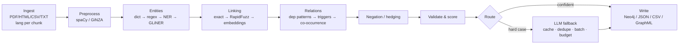

# Architecture

Every stage is a class with `process(doc) -> doc` (stages that need the whole corpus also
implement `process_many`). Stages are testable alone and can be skipped by config.



| Stage (registry name) | Module | Notes |
|---|---|---|
| `ingest` | `stages/ingest` | cleaning, kana/CJK-ratio language detection per paragraph, sentence-aware chunks (800 EN / 400 JA chars) |
| `preprocess` | `stages/preprocess` | runs the chunk language's spaCy pipeline per sentence |
| `dictionary` | `stages/entities/dictionary.py` | EN `PhraseMatcher(LOWER)`; JA character Aho-Corasick on normalized text |
| `regex` | `stages/entities/regex.py` | per-language patterns on NFKC text |
| `ner` | `stages/entities/ner.py` | spaCy/GiNZA/scispaCy labels → ontology types (`models.yaml`) |
| `gliner` | `stages/entities/gliner_stage.py` | only on sentences with few entities |
| `linking` | `stages/linking` | concept ids shared across languages → one entity per concept |
| `dependency` | `stages/relations/dependency.py` | `DependencyMatcher` patterns from the pack |
| `trigger` | `stages/relations/trigger.py` | trigger words, windows in tokens (EN) / bunsetsu (JA) |
| `cooc` | `stages/relations/cooc.py` | schema-allowed pairs only (JA: bunsetsu-connected) |
| `negation` | `stages/relations/negation.py` | via `LanguageProfile.negation_hedge` |
| `validate` | `stages/validate` | schema, direction, confidence, duplicate merge, provenance |
| `route` | `stages/route/router.py` | hard-case rules, `reason` enum |
| `llm` | `stages/route/llm_stage.py` | resolver + client (Groq / Ollama / fake / none) |
| `embed` | `stages/linking/chunk_embed.py` | chunk vectors for the Neo4j vector index |
| `write` | `stages/write` | merge into the corpus graph; exporters run at the end |

## Graph model

```
(:Document {id,title,source,url,date,lang})-[:HAS_CHUNK]->
(:Chunk {id,text,lang,embedding})-[:MENTIONS {start,end,method,lang,confidence}]->
(:Entity:<Type> {id,name,name_ja,aliases_en,aliases_ja,ontology_id,domain,lang_seen})
(:Entity)-[:<REL> {negated,confidence,method,status,evidence_count,chunk_ids,langs,provenance_json}]->(:Entity)
```

Constraints on `Document.id`, `Chunk.id`, `Entity.id`; full-text indexes `entity_names` and
`chunk_text` with the `cjk` analyzer; vector index `chunk_embedding` when chunks have
embeddings. Writes are batched `UNWIND … MERGE` (1,000 rows) and idempotent.

## Two rules the engine keeps
1. **Domain-agnostic** — no domain term appears under `src/leankg/`; packs hold ontology,
   dictionaries, patterns, model names and LLM hints.
2. **Language-agnostic** — no `if lang == "ja"` outside `src/leankg/lang/`; stages ask the
   `LanguageProfile` (`normalize`, `split_sentences`, `units`, `connected`,
   `negation_hedge`, `dict_strategy`, …).
